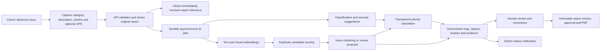
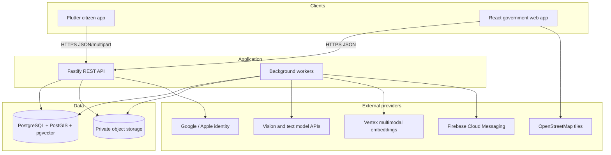

# CivicAI: Product and Technical Design Defense

**Document purpose:** Product overview, implemented feature inventory, architecture rationale, AI design, security and privacy posture, limitations, validation evidence, and defense talking points.

**Repository status date:** 15 October 2026  
**Product stage:** MVP implementation; production shipping validation is still pending.

---

## 1. Executive summary

CivicAI is an AI-assisted civic infrastructure reporting and decision-support platform. It gives citizens a simple mobile workflow for reporting issues such as potholes, flooding, waste, damaged public assets, and other environmental or infrastructure problems. It then converts many individual observations into traceable issue clusters that government officers can inspect, prioritize, review, and turn into formal reports.

The product addresses two connected problems:

1. Citizens often lack a reliable, transparent channel for reporting local problems and following their progress.
2. Government teams can receive many fragmented reports about the same underlying problem, making triage and evidence review slow and inconsistent.

The core product principle is:

> A citizen report is an observation. An issue cluster represents the underlying civic problem.

This distinction prevents CivicAI from treating every submission as a separate infrastructure failure. For example, 20 photographs of one flooded junction should remain 20 citizen observations but may support one operational issue. The originals are never deleted or silently rewritten when the system groups them.

CivicAI does not allow AI to become the final authority. AI proposes classifications, severity, similarity, grouping, and priority. The platform preserves confidence, evidence, model and scoring versions, missing inputs, and human corrections. Government administrators can review and override grouping decisions, and all important review actions are auditable.

---

## 2. Problem statement

Public infrastructure reporting is commonly fragmented across calls, messages, social media posts, paper records, and agency-specific systems. These channels produce several operational weaknesses:

- incomplete or inconsistent evidence;
- unclear location and time of occurrence;
- duplicate reports that inflate apparent workload;
- difficulty identifying the most urgent recurring issues;
- weak feedback to citizens after submission;
- little traceability between a summary and the observations supporting it; and
- manual preparation of reports for administrative action.

CivicAI creates a structured evidence chain from citizen submission to government review. A report can include a category, description, one to five photographs, GPS coordinates, GPS accuracy, a human-readable address, and submission time. The platform protects the original observation while creating derived intelligence around it.

## 3. Product vision and objectives

The product vision is to make civic reporting easier for citizens and civic decision-making more evidence-based for government.

The MVP objectives are to:

- reduce the effort required to submit a useful report;
- continue working under unreliable connectivity;
- preserve original citizen evidence;
- identify likely duplicate observations;
- group reports into operational issues without losing their provenance;
- estimate issue severity and priority transparently;
- give officers map, search, filter, evidence, and review tools;
- communicate status changes back to citizens; and
- produce immutable, reviewable government report versions and PDFs.

### 3.1 Actors and roles

| Actor | Main responsibilities | Access boundary |
| --- | --- | --- |
| Citizen | Register, submit reports, review their own history and status, manage notification preferences | Can access only their own reports and notifications |
| Government operator | Inspect the global operational dataset, maps, reports, clusters, evidence, priorities, and reporting history | Read-oriented operational access; cannot perform administrator-only approvals or mutations |
| Government administrator | Manage government access, correct cluster membership, review proposals, and approve report versions | Elevated actions are checked against the current database role and status |
| AI/background workers | Produce suggestions and derived intelligence | Cannot replace the original citizen category, description, photos, or report status |

### 3.2 What CivicAI owns

CivicAI owns citizen reports and media, location evidence, AI suggestions, duplicate candidates, issue clusters, severity and priority calculations, review history, notification records, and generated issue reports.

It does not own an agency's internal procurement, work-order, dispatch, contractor, or financial systems. The current product can prepare evidence for manual or later electronic forwarding, but it does not claim that submitting or approving a CivicAI report automatically repairs an asset.

---

## 4. End-to-end product journey



The synchronous path ends after the report is safely committed. AI work is asynchronous, so a model outage, slow provider, unsupported image, or missing configuration does not prevent the citizen from reporting a problem.

---

## 5. Product features

### 5.1 Citizen mobile application

The citizen client is a Flutter application designed for Android-first deployment while retaining an iOS-compatible codebase.

#### Identity and access

- Email/password registration and sign-in.
- NIN-backed account creation and uniqueness validation.
- Google and Apple identity sign-in for an already linked citizen account; provider tokens are verified by the API.
- Password reset using a time-limited emailed code.
- Secure device storage for session tokens.
- Silent access-token refresh and logout cleanup.
- Route guards that prevent unauthenticated access to protected screens.

#### Report creation

- Six database-backed report categories.
- One to five photographs from camera or gallery.
- Image downsampling during selection to control upload size and bandwidth.
- Description entry with a 1,000-character limit.
- Best-effort GPS capture with preserved accuracy.
- Best-effort reverse geocoding.
- Explicit handling of location services being disabled, denied, permanently denied, or unable to obtain a fix.
- Optional location so indoor users or users with denied permissions can still report.
- Stable submission identifier for idempotent retries.

#### Offline and unreliable-network support

- Failed transient submissions are stored in an account-scoped durable local queue.
- Photos are copied into application support storage rather than relying on temporary picker paths.
- Retry occurs after session restoration, network reconnection, or a manual citizen action.
- Successful synchronization removes the local queued copy.
- HTTP validation/authentication failures are not retried indefinitely because user action is required.
- Server-side idempotency prevents an ambiguous timeout from creating duplicate reports.

#### Citizen transparency and engagement

- Home summary and impact score.
- Full report history with server-side search, status filtering, pagination, and pull-to-refresh.
- Report detail view with original description, location, photo gallery, lifecycle events, assigned-agency state, cluster priority, and reference number.
- Status values: Pending, In Progress, Resolved, and Rejected.
- AI category suggestion shown as a second opinion without changing the citizen's chosen category.
- Text receipt generation and native share sheet.
- Durable in-app notification inbox, preferences, report deep links, and FCM device registration.
- Profile editing, dark mode, language screen, help/support, about, and installed app version.

Physical-device push delivery and production Firebase/APNs setup remain release gates rather than completed production evidence.

### 5.2 Government web application

The government client is a responsive React and TypeScript web application focused on operational review.

#### Authentication and administration

- Separate government authentication endpoints.
- Citizen accounts are rejected from the government workspace.
- Invite-gated operator and administrator registration.
- One-time invite creation and revocation.
- Government account suspension and reactivation.
- Current role and account status are read from the database for protected actions instead of trusting a possibly stale JWT claim.
- Browser tokens remain in memory; a page reload requires sign-in again. This reduces persistence exposure but sacrifices session convenience in the MVP.

#### Operational overview

- Global report and issue totals.
- Report lifecycle and category breakdowns.
- Grouping review backlog, unassigned reports, missing-GPS counts, and priority readiness.
- Latest citizen observations with West Africa Time presentation.
- Manual refresh plus loading, empty, error, and retained-last-good-snapshot states.

#### Map and report investigation

- Leaflet map with separate report-location and issue-centroid layers.
- Viewport-scoped GeoJSON loading and independent layer caps.
- Category and lifecycle filters.
- Nigeria reset view, visible attribution, accessible result lists, marker selection, and map failure states.
- Full-dataset report search and filtering by status, category, date, GPS availability, and cluster assignment.
- Report detail with original text, location, accuracy, status, cluster, and ordered photographs.
- Private photographs are exposed only through short-lived signed URLs.

#### Issue clusters and explainability

- Searchable, paginated issue-cluster list.
- Cluster status, category, member count, centroid, priority state, and review counts.
- Source evidence cards containing original report references, descriptions, dates, locations, GPS accuracy, lifecycle states, and photographs.
- Grouping explanation showing assignment method, matched report, distance, semantic similarity, visual similarity when available, category match, combined score, thresholds, algorithm versions, and competing candidates.
- Explicit states for missing GPS, missing signals, unavailable AI, singleton creation, uncertainty, and processing failure.
- No citizen identity is included in ordinary dashboard overview or cluster evidence responses.

#### Human review and correction

- Review queue for ambiguous or below-automatic-threshold grouping proposals.
- Administrator approval or dismissal of a proposal with a mandatory reason.
- Move, remove, split, and merge cluster membership operations.
- Same-category and open-cluster invariants.
- Human changes become authoritative membership assignments.
- Append-only review actions preserve reviewer, time, reason, and before/after state.
- Operators can inspect review history without receiving administrator mutation privileges.

#### Government reporting

- Live issue-report compilation from current cluster and source evidence.
- Cited findings, source register, observation window, evidence appendix, disagreements, and uncertainties.
- Clear `BLOCKED`, `NEEDS_REVIEW`, or `READY_FOR_REVIEW` readiness status.
- A live compilation is labelled an unapproved draft.
- Numbered immutable report versions preserve the exact JSON evidence snapshot and private media manifest.
- Administrator approval binds to a specific immutable version and required approval statement.
- Multi-page A4 PDF generation from either live or versioned evidence.
- Print-optimized browser view.
- Paginated reporting audit history for creation and approval events.

### 5.3 Notifications and observability

- Status-change notifications are stored durably before push delivery.
- FCM delivery runs through a retrying background worker and respects citizen preferences and active device registrations.
- Health endpoints distinguish process liveness from database readiness.
- Protected Prometheus metrics support operational monitoring.
- Structured logs carry request identifiers and redact authorization and cookie headers.
- Graceful shutdown stops workers and drains HTTP/database resources.

---

## 6. Technical architecture

### 6.1 Implemented stack

| Layer | Technology | Why it fits the MVP |
| --- | --- | --- |
| Citizen client | Flutter/Dart, Provider, Dio, GoRouter | One mobile codebase, strong camera/GPS integration, predictable native deployment |
| Government client | React 19, TypeScript, Vite, Leaflet | Fast desktop web delivery, typed UI contracts, mature mapping ecosystem |
| API and workers | Node.js, TypeScript, Fastify, Zod | Shared language with the web client, high I/O concurrency, schema validation, low-overhead HTTP server |
| Data | PostgreSQL, PostGIS, pgvector through Supabase-hosted services | Transactions, relational integrity, geographic queries, and vector search in one source of truth |
| Media | Private S3-compatible/Supabase object storage | Keeps large binary media outside database rows while supporting signed temporary access |
| AI providers | OpenAI-compatible vision/text APIs and Vertex AI multimodal embeddings | Pretrained capability reduces MVP training cost and time; provider use remains feature-gated |
| Push | Firebase Cloud Messaging HTTP v1 | Cross-platform device delivery with server-side credentials |
| Validation | Node test runner, Flutter tests/analyzer, TypeScript builds, live rollback-safe scripts, CI | Covers pure logic, API contracts, UI behavior, compilation, and selected database behavior |

### 6.2 Runtime component view



The browser requests map tiles directly from the configured tile provider. Authenticated CivicAI data remains on the CivicAI API.

### 6.3 Repository boundaries

- `apps/citizen`: Flutter citizen application.
- `apps/government`: React government operations application.
- `services/api`: REST API, background workers, model-provider clients, and PDF generation.
- `supabase/migrations`: ordered database and storage schema changes.
- `docs`: architecture, contracts, operations, product status, and release guidance.

The architecture originally reserved `services/ai` for a Python/FastAPI service. The implemented MVP currently keeps queue orchestration and provider adapters in the TypeScript API service. This removes an extra network hop and deployment unit while throughput is low. AI capabilities are already separated into classification, text embedding, visual embedding, duplicate detection, clustering, severity, and priority modules, so they can later move behind a Python service or independent workers without changing the citizen-facing contract.

---

## 7. Data design and integrity

### 7.1 Why PostgreSQL is the system of record

The domain is strongly relational: a user owns reports; a report references a category and optional location; media belongs to a report; a report can have one current cluster membership; a cluster contains many reports; and review/reporting events reference both actors and evidence. PostgreSQL provides foreign keys, constraints, transactions, indexes, JSONB snapshots, and reliable concurrency control in one platform.

PostGIS supports distance, viewport, centroid, and geometry operations. pgvector stores semantic and visual vectors alongside the records they describe. This reduces operational complexity compared with introducing separate document, geographic, vector, and queue databases during an MVP.

### 7.2 Important domain records

- `users` and hashed `refresh_tokens` for identity and sessions;
- `reports`, `report_categories`, `locations`, and `report_media` for original observations;
- `report_ai_analyses`, `report_embeddings`, and `report_visual_embeddings` for model jobs/results;
- `report_duplicate_searches` and `report_duplicate_candidates` for similarity evidence;
- `issue_clusters`, `issue_cluster_reports`, `report_cluster_decisions`, and review candidates/actions for grouping and correction;
- priority jobs and immutable priority calculations;
- immutable issue-report versions and approvals;
- citizen notifications, preferences, and device tokens.

### 7.3 Transaction boundaries

Report media uploads happen before the report database transaction because object storage and PostgreSQL cannot share one distributed transaction. If the database transaction fails, the API performs compensating cleanup of uploaded objects. Inside PostgreSQL, the location, report, media rows, and relevant job records commit together.

Cluster review mutations use a database transaction and serialize with the clustering worker. Report version numbers are allocated atomically. Priority calculation reads a repeatable snapshot. These choices prevent partial membership changes, duplicate version numbers, and calculations assembled from inconsistent evidence.

### 7.4 Immutable evidence and auditability

Original citizen descriptions and media are not replaced by AI output. Model outputs and scoring decisions are separate records. A saved issue-report version captures the evidence and media manifest used at that moment, so later membership changes do not rewrite an already reviewed report. Approvals attach to one exact version rather than to a mutable cluster.

---

## 8. AI design

### 8.1 AI is an enhancement, not a write-path dependency

Every model-backed capability is independently feature-gated. A report is accepted before inference occurs. Disabled AI, a missing credential, a provider outage, or low confidence cannot destroy or block the original report.

The PostgreSQL-backed queue was selected for the MVP because the job and its source record can be committed in the same transaction. Workers claim rows with `FOR UPDATE SKIP LOCKED`, enabling safe concurrent processing without a second queueing platform. Stale jobs, bounded retries, attempt checks, error codes, and terminal states make failure visible. A dedicated broker such as Redis, RabbitMQ, or a managed queue becomes justified when throughput, scheduling, isolation, or independent scaling exceeds the database queue's practical limits.

### 8.2 Pipeline stages

1. **Image classification:** Suggests a category and supporting visual evidence. The citizen-selected category remains unchanged.
2. **Severity estimation:** Suggests `LOW`, `MODERATE`, `HIGH`, `CRITICAL`, or `UNSURE` using a fixed rubric. Low confidence results remain visible but are not accepted as a severity input.
3. **Semantic embedding:** Creates a 1,536-dimensional vector from category, description, address, and available classification evidence.
4. **Visual embedding:** Creates a 1,408-dimensional vector for supported JPEG/PNG report photographs through Vertex AI.
5. **Duplicate candidate search:** Compares open reports within a configurable geographic radius and stores the strongest candidates and component signals.
6. **Issue clustering:** Automatically assigns only strong, unambiguous same-category candidates. Otherwise it creates a singleton and a review proposal.
7. **Priority calculation:** Produces a transparent score or an incomplete range from cluster evidence and verified context.

### 8.3 Duplicate scoring

The current visual-aware score is:

```text
duplicate score =
    0.30 × geographic closeness
  + 0.30 × visual similarity
  + 0.30 × semantic similarity
  + 0.10 × category match
```

If either report lacks a compatible completed visual vector, the explicitly versioned fallback is:

```text
fallback score =
    0.40 × geographic closeness
  + 0.40 × semantic similarity
  + 0.20 × category match
```

Candidates below the configured minimum are discarded, and only the strongest bounded set is retained. Storing each component and a scoring-version label makes the output explainable and prevents future formula changes from silently changing the meaning of historical scores.

### 8.4 Cluster assignment controls

- Only open reports can join open clusters.
- Citizen-selected categories must match for automatic assignment.
- The report must remain within the configured radius of the cluster's fixed seed location. This prevents transitive “chain” growth in which A is near B and B is near C, but A and C are too far apart to describe one local issue.
- The best distinct cluster must reach the automatic threshold, currently defaulting to `0.85`.
- If the runner-up is within the ambiguity margin, currently `0.05`, the system requests review rather than pretending certainty.
- Human membership decisions are preserved across worker retries.
- Weighted similarity values are decision scores, not calibrated probabilities.

### 8.5 Priority design

Priority intentionally differs from severity. Severity describes how serious the visible condition appears; priority describes what government should attend to first using broader operational context.

```text
priority =
    40% severity
  + 20% report volume
  + 15% persistence / age
  + 15% population context
  + 10% location importance
```

Unknown inputs are not silently redistributed across known inputs. A cluster can therefore be `INCOMPLETE` with a lower and upper bound, `UNAVAILABLE` when it lacks usable severity, or `INACTIVE` when closed. Completed scores map to Low, Medium, High, or Urgent bands. Missing inputs, critical severity, or unresolved grouping proposals trigger review.

This design prefers honesty over a deceptively precise number. Population and location-importance values require sourced operator input; the model is explicitly instructed not to invent them from coordinates or an address.

### 8.6 Responsible-AI safeguards

- AI output never overwrites original citizen evidence.
- Low confidence becomes uncertainty, not a forced classification.
- `UNSURE` or missing evidence never becomes “low severity.”
- Prompts separate visible evidence, unverified citizen text, location context, and uncertainty.
- Model/provider name, returned version, threshold, rubric/scoring version, input snapshot, attempt status, and timestamp are retained.
- Automatic grouping and administrator approval are different states.
- Government users can see why a grouping occurred and can inspect competing candidates.
- Critical and unavailable severity require review.
- Scores support triage; they are not verified facts or legal findings.

### 8.7 Why pretrained models instead of training from scratch

Training several production-quality models would require a large, representative, labelled Nigerian civic dataset; specialist ML operations; bias and calibration work; substantial compute; and ongoing monitoring. The MVP instead uses pretrained model APIs behind replaceable adapters and records provider/model versions. This tests the workflow and generates reviewed domain data before committing to custom training. A later model should be evaluated on local conditions, lighting, device quality, road types, drainage patterns, and class imbalance before replacement.

---

## 9. Key technical design choices and defense rationale

| Decision | Rationale | Tradeoff / mitigation |
| --- | --- | --- |
| Flutter for citizens | One codebase with native camera, location, secure storage, permissions, push, Android and iOS support | Larger binary and some plugin/platform complexity; isolate device services behind app service classes |
| React web for government | Government work is information-dense and desktop-oriented; browser delivery avoids installation and simplifies updates | Separate UI codebase from Flutter; shared contracts and API boundaries reduce drift |
| Fastify + TypeScript | Strong I/O performance, typed implementation, plugin ecosystem, and language alignment with government web | CPU-heavy ML does not belong on the event loop; inference is remote/asynchronous and can be extracted |
| PostgreSQL/PostGIS/pgvector | Transactions, geospatial queries, vectors, relational evidence, and queues in one operational store | Scaling all workloads in one database can create contention; indexes, bounded queries, worker limits, and future service separation mitigate it |
| REST API | Clear resource boundaries, straightforward mobile/web support, cache/debug tooling, and explicit versionable contracts | Some dashboard calls are composite; purpose-built overview/compilation endpoints avoid excessive client round trips |
| Private object storage | Database stays lean and photos remain access-controlled | Storage/database commits are not atomic; compensating deletion handles failed report transactions |
| Signed media URLs | Temporary least-privilege access without proxying every byte through the API | URLs remain usable until expiry; government links use short lifetimes and bucket remains private |
| PostgreSQL-backed jobs | Atomic enqueue with report creation and minimal MVP infrastructure | Database polling is not ideal at large scale; queue interfaces and independent workers support later migration |
| Asynchronous AI | Fast, reliable submission and failure isolation | Intelligence appears eventually; UI exposes pending/failed/unavailable states |
| Feature flags per AI capability | Controls cost, rollout, provider failure, backfill, and experimentation | Configuration becomes more complex; startup logs and runbooks expose active capability state |
| Fixed, versioned scoring formulas | Explainable and reproducible decisions | Hand-selected weights require empirical validation; immutable snapshots permit later comparison and recalibration |
| Human-in-the-loop grouping | Prevents uncertain model output from becoming unquestioned government truth | Adds review workload; high-confidence unambiguous cases can still be automated |
| In-memory government browser tokens | Reduces exposure through persistent browser storage | Reload loses the session; acceptable for MVP, with secure cookie/BFF design a possible production improvement |
| Immutable report versions | Approval must refer to exact evidence, not a changing live cluster | Additional storage; JSONB snapshots and media manifests are worth the audit value |
| Optional GPS | Inclusion and report availability take priority over forcing location permission | Reports without GPS cannot use normal geographic matching; they are clearly marked for manual handling |
| Idempotent submissions | Prevents duplicate reports after uncertain mobile timeouts | Requires stable client UUID and a citizen-scoped uniqueness constraint |

---

## 10. Security and privacy design

### 10.1 Authentication and session security

- Passwords are bcrypt-hashed; government registration uses a higher cost than citizen registration.
- Access tokens are short-lived (15 minutes).
- Refresh tokens are cryptographically random, stored only as SHA-256 hashes, expire after 30 days, rotate on use, and can be revoked per device or globally.
- Citizen mobile tokens use keychain/keystore-backed secure storage.
- Social identity tokens are verified server-side against provider signing keys and expected claims.
- Government roles cannot be self-selected: the one-time invite determines the assigned role.
- Protected government actions recheck current role and active status in PostgreSQL, so suspension or role changes take effect without waiting for JWT expiry.
- Production refuses to start without an explicit JWT secret and password-reset pepper.

### 10.2 Authorization and data minimization

- Citizen report, summary, detail, notification, and preference queries are owner-scoped.
- Government and citizen authentication paths are separated.
- Administrator-only mutations have a distinct database-verified guard.
- Common government responses omit citizen identity and internal storage keys.
- Signed URLs provide temporary access to private media.
- Sensitive provider credentials live only on the API/server side.

### 10.3 API and operational controls

- Zod schemas validate request shape and reject unknown or malformed values at boundaries.
- Multipart uploads enforce size and count limits plus supported media validation.
- Rate limiting applies globally, with tighter authentication limits.
- Production CORS uses an explicit origin allowlist.
- Generic server errors avoid leaking database statements, stack traces, or secrets.
- Logs redact authorization and cookie headers and include request IDs.
- Liveness, readiness, protected metrics, and graceful shutdown support safer operations.

### 10.4 Privacy risks still requiring release governance

NIN, precise location, photographs, identity, and AI evidence are sensitive. Production release still requires a documented lawful basis, consent language, retention/deletion policy, correction/export workflow, least-privilege database/storage roles, secret management, backup/restore controls, privacy policy, and incident response. These are not solved merely by writing secure application code.

MFA is an intended government security control but is not yet evidenced as implemented in the current MVP. It should remain a production gate rather than be presented as delivered.

---

## 11. Reliability, concurrency, and failure handling

- Report creation uses database transactions and compensating media cleanup.
- Client submission IDs make retries idempotent.
- Worker claims use row locks with `SKIP LOCKED` so multiple workers do not process one job simultaneously.
- Attempts are bounded, transient failures are delayed before retry, and stale processing records can be reclaimed.
- Attempt-aware updates prevent an expired worker from overwriting a later attempt.
- Cluster membership is unique per report.
- An advisory transaction lock serializes automatic clustering with human cluster edits.
- Priority calculation uses repeatable-read evidence snapshots.
- Empty clusters remain available for audit rather than being erased.
- UI screens retain the last successful snapshot when refresh fails, while visibly reporting that the refresh failed.
- Map and list queries use bounded pagination/caps to protect the API and browser.

---

## 12. Testing and validation strategy

The project uses several levels of evidence:

1. **Pure logic tests:** scoring, thresholds, severity decisions, impact score, date handling, parsing, and navigation decisions.
2. **API tests:** authentication, owner scoping, schema validation, worker behavior, retries, government authorization, map/report/cluster contracts, notifications, PDF generation, and audit actions.
3. **Client tests:** Flutter provider/model/router behavior and government web session/API/view behavior.
4. **Build and static validation:** TypeScript production builds, Flutter analyzer, and Flutter tests.
5. **Database validation:** rollback-safe scripts exercise selected real PostgreSQL/PostGIS queries, spatial fixtures, authorization, priority branches, and cluster actions.
6. **Browser interaction checks:** important government workflows have been exercised with controlled API responses, including responsive and failure states.
7. **Continuous integration:** pull requests and the main branch run API and government tests/builds plus Flutter analysis/tests.

The latest project progress record states that 183 API tests, 21 government web tests, and 48 Flutter tests pass, with clean builds/analyzer as applicable. These numbers are a repository status snapshot, not a permanent quality guarantee; they should be refreshed before the defense or release.

Unit and mocked integration tests deliberately avoid paid model calls. The full model-backed AI path, production credentials, physical-device push delivery, production deployment, load/soak behavior, restore drills, and complete end-to-end acceptance remain shipping gates.

---

## 13. Current implementation status and honest limitations

### Implemented in the MVP codebase

- Citizen authentication, reporting, history, details, offline queue, notifications, profile/settings, and report receipts.
- Government authentication/admin, overview, map, report search/details, cluster/evidence views, grouping explanations, review queue, and administrator cluster corrections.
- Durable classification, semantic embedding, visual embedding, duplicate, clustering, severity, priority, and push worker implementations.
- Live report compilation, PDF/print, immutable versions, approval, and reporting audit history.
- Core hardening: rate limits, safe errors, redacted logs, health/readiness, metrics, graceful shutdown, automated tests, and CI.

### Not yet fully production-validated

- The complete paid model path from a new report through all AI stages.
- OpenAI/Vertex model availability, accuracy, cost controls, and local-domain evaluation.
- The newest notification and visual-embedding migrations in the configured live environment.
- Physical Android/iOS push delivery and production Firebase/APNs configuration.
- Complete live/browser validation for every cluster and review view.
- End-to-end browser password sign-in with a provisioned government account.
- Production infrastructure, HTTPS/DNS, secret manager, alerting, backups, recovery objectives, app-store signing, privacy/legal readiness, accessibility, load testing, and penetration/security review.

### Known AI pipeline risks recorded by the project

- A terminal semantic-embedding failure can leave a report without duplicate search and therefore without a documented cluster/singleton outcome.
- Out-of-order embedding completion can miss a valid earlier/later duplicate relationship because current search ordering is directional.
- A government priority response currently risks including `citizenId` inside an input snapshot, and one priority authorization helper needs stronger error handling.
- Automatic clustering does not automatically merge clusters created separately by late evidence; human review is required.
- Scores and thresholds have not yet been calibrated on a representative Nigerian civic dataset.

These are important defense points: they show that the team understands the system's failure modes and does not confuse code completion with production readiness.

---

## 14. Alternatives considered

### One application for both citizens and government

Rejected for the MVP because the audiences, threat models, devices, and workflows differ. Citizens need fast mobile capture and intermittent-network support. Government users need dense tables, maps, evidence comparison, printing, and access administration on larger screens.

### Synchronous AI during submission

Rejected because report availability is more important than immediate inference. Synchronous inference increases latency, model cost exposure, timeout risk, and the chance that a provider failure blocks a legitimate civic report.

### One large AI prompt or service

Rejected because classification, severity, embedding, matching, clustering, and priority have different inputs, failure modes, costs, and validation criteria. Independent capabilities can be disabled, retried, versioned, replaced, and explained separately.

### Priority equals severity

Rejected because a severe isolated defect and a persistent issue affecting many people are operationally different. Priority therefore includes volume, time, population context, and location importance while keeping missing context visible.

### Store photographs directly in PostgreSQL

Rejected because large binaries increase database size, backup cost, and query/storage pressure. Object storage is better suited to media; PostgreSQL stores controlled references and metadata.

### Redis or a managed broker from day one

Deferred because the initial throughput does not justify another stateful operational dependency. PostgreSQL allows the job and source report to commit together. A dedicated broker is the planned scale boundary, not a rejected technology.

### Fully automatic grouping with no review

Rejected because incorrect grouping can distort government priorities and official reports. Conservative thresholds, ambiguity detection, singletons, review proposals, and human corrections make automation accountable.

---

## 15. Scalability and evolution plan

The current design is appropriate for an MVP and pilot, but scale should be evidence-driven.

1. Add query and worker metrics, queue-depth alerts, model spend budgets, and capacity baselines.
2. Fix the known terminal-failure and out-of-order duplicate-search gaps.
3. Move background work to a managed queue when polling or database contention becomes material.
4. Separate AI workers into independently deployable services when they need distinct runtimes, GPUs, scaling, or release cycles.
5. Add a production tile provider or self-hosted policy-compliant map infrastructure.
6. Introduce CDN/image transformations for high media traffic without making buckets public.
7. Partition/archive high-volume audit and job tables only after measured growth justifies it.
8. Evaluate and calibrate models on a reviewed Nigerian dataset; monitor drift and category-specific error rates.
9. Add agency/work-order integrations through explicit adapters without making an external agency database CivicAI's source of truth.
10. Adopt secure browser session persistence, MFA, stronger device/session management, and formal data-retention automation before broad rollout.

---

## 16. Success metrics

### Citizen experience

- report completion and successful synchronization rate;
- median time from opening the form to receiving a report reference;
- offline-queue eventual delivery rate;
- percentage of reports with usable media and location;
- notification delivery/open rate; and
- citizen return rate to view status.

### Intelligence quality

- classification accuracy and coverage by category;
- severity agreement with trained reviewers;
- duplicate precision/recall and cluster purity;
- percentage of assignments requiring administrator correction;
- uncertainty and terminal-failure rates; and
- model cost and latency per report.

### Government operations

- time from submission to first government review;
- review-queue age;
- time to produce an approved evidence report;
- percentage of priority calculations complete versus incomplete;
- resolution time by category and area; and
- traceability coverage from every report finding to source evidence.

Metrics must be interpreted carefully. For example, a higher report volume may reflect improved access rather than worsening infrastructure, and “resolution” needs a controlled operational definition rather than a simple UI status change.

---

## 17. Suggested defense presentation flow

### 1. Problem and users — 1 minute

Explain fragmented civic reporting and the two user groups. State that the product turns observations into reviewable civic intelligence.

### 2. Product demonstration — 4 minutes

1. Sign in as a citizen.
2. Create a report with category, description, photograph, and location.
3. Show the immediate report reference and history/detail view.
4. Open the government overview and map.
5. Open the report's issue cluster and supporting evidence.
6. Show the grouping explanation and an uncertain review proposal.
7. Demonstrate an administrator correction and audit history.
8. Compile, version, approve, and download an issue PDF.
9. Return to the citizen view to show status/notification transparency.

If live model credentials are not configured, say so before the demo and use seeded results. Never imply that a seeded or mocked inference was produced live.

### 3. Architecture — 2 minutes

Show the component diagram. Emphasize asynchronous AI, PostgreSQL as the system of record, private object storage, owner/role boundaries, and immutable evidence.

### 4. Design decisions — 2 minutes

Defend Flutter vs React, PostgreSQL/PostGIS/pgvector, database-backed jobs, human-in-the-loop AI, optional GPS, idempotent mobile uploads, and versioned scoring.

### 5. Validation and limitations — 1 minute

Present test/build evidence, then name the remaining end-to-end, security, legal, physical-device, and AI-calibration gates. Honest limitation disclosure strengthens the defense.

---

## 18. Likely defense questions and concise answers

### “What makes this an AI product rather than an ordinary complaint form?”

The original complaint remains the source evidence, but AI adds category suggestions, severity assessment, semantic and visual representations, duplicate candidates, issue grouping, and priority inputs. The important innovation is not merely calling a model; it is turning those outputs into an auditable, human-reviewable civic workflow.

### “Why not let the model decide everything?”

Civic decisions affect public resources and can be based on incomplete or misleading evidence. Models are fallible and their confidence is not a verified probability. CivicAI automates strong, unambiguous cases, exposes reasoning and uncertainty, and reserves correction and formal approval for authorized humans.

### “How do you prevent duplicate reports?”

There are two different duplicate problems. Network retries are controlled through a stable citizen-scoped submission ID. Real-world duplicate observations are preserved but linked through geographic, semantic, visual, and category similarity into one issue cluster.

### “Why preserve duplicate observations?”

They are independent evidence of volume, persistence, and community impact. Deleting them would lose provenance and could hide disagreement. The cluster reduces operational duplication while the source reports remain inspectable.

### “Why is location optional if geography is central?”

Forcing location would exclude indoor users, people who deny permission, devices with a poor fix, and urgent submissions under degraded conditions. CivicAI accepts the observation, marks location as unavailable, avoids false precision, and routes it to manual handling rather than discarding it.

### “How is an AI score explained?”

The system stores each input signal, weight, threshold, model/scoring version, matched report, and outcome. The dashboard shows these components and missing values. Historical outputs retain their original version, so a later formula change does not rewrite the past.

### “What happens when AI is down?”

The citizen report still commits and receives a reference. AI jobs remain pending, retry transient failures, or end in an explicit failed/skipped state. Workers are independently feature-gated, and the dashboard exposes unavailable or incomplete intelligence.

### “Why use a database as a queue?”

At MVP scale it provides the strongest simplicity benefit: the report and its job commit atomically, and row locking safely supports concurrent workers. A dedicated queue becomes appropriate when monitoring shows database contention, higher throughput, or a need for independent scaling and scheduling.

### “How do you protect citizen privacy?”

Citizen queries are owner-scoped; government access is role/status checked; normal operational responses minimize identity; media stays private behind expiring signed URLs; refresh tokens are hashed; logs redact credentials; and model credentials remain server-side. Production also requires policy controls for consent, NIN/location retention, deletion, auditing, backups, and incident response.

### “Why are priority inputs not reweighted when data is missing?”

Reweighting would imply that known inputs have more importance than the published policy and could generate a confident-looking score from incomplete evidence. CivicAI keeps the intended weights and reports a range or incomplete state instead.

### “Why not use microservices immediately?”

The MVP benefits from one deployable API and one transactional database while the team validates product behavior. Module boundaries and asynchronous jobs already isolate capabilities. Splitting deployment units before there is scaling or ownership pressure would add network failure modes and operational overhead without improving user value.

### “Is the project production-ready?”

No. It has substantial implemented and tested MVP functionality, but production release still depends on live AI validation, physical-device notification testing, production infrastructure and secrets, legal/privacy controls, load and security testing, backup/restore evidence, and closure of known pipeline/privacy gaps.

### “What is the most important technical contribution?”

The strongest contribution is the traceable transformation from individual observations into an operational issue without losing originals: versioned similarity signals, conservative cluster assignment, human corrections, immutable evidence snapshots, and approval bound to an exact report version.

---

## 19. Defense-ready closing statement

CivicAI was designed around a practical principle: public-sector AI must improve the organization of evidence without becoming an unaccountable source of truth. The platform makes reporting accessible, tolerates weak connectivity, preserves original observations, derives explainable issue intelligence, and gives authorized officers the tools to verify and correct it. Its MVP architecture deliberately favors transactional integrity, modular asynchronous AI, explicit uncertainty, and auditability. The remaining work is clearly separated from implemented capability, providing a credible path from a tested prototype to a secure production service.

---

## 20. Repository references

- [Architecture overview](architecture.md)
- [AI strategy and pipeline](ai_strategy.md)
- [Project progress and implementation status](progress.md)
- [Database and migrations](database.md)
- [Citizen report API](reports-api.md)
- [Government dashboard API](government-dashboard-api.md)
- [Government map API](government-map-api.md)
- [Government reports API](government-reports-api.md)
- [Government cluster API](government-clusters-api.md)
- [Government reporting API](government-reporting-api.md)
- [Hardening operations](hardening.md)
- [Production shipping checklist](shipping.md)

